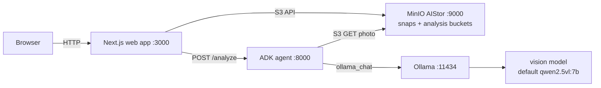
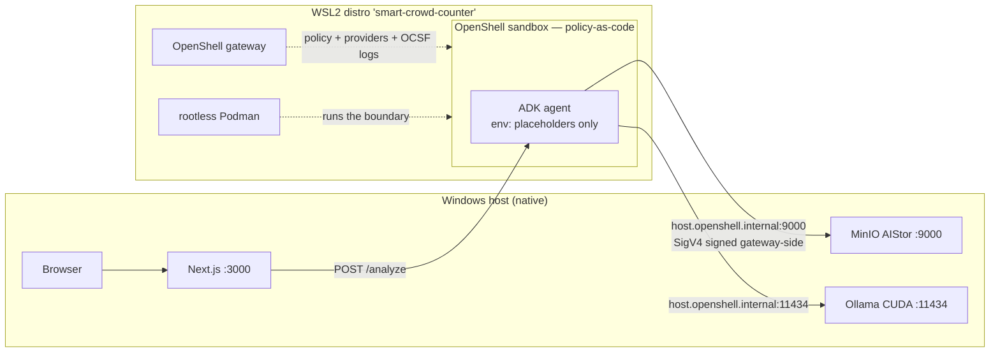
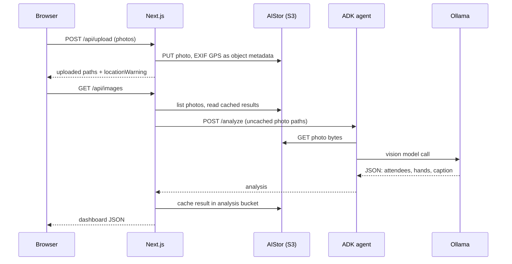

# Smart Crowd Counter

[](LICENSE)


[](docker-compose.yml)

Upload conference session photos and get estimates of attendee count, raised hands, and a caption for each photo. Everything runs on your own machine: a Google ADK agent calls a local Ollama vision model, and photos are stored in MinIO AIStor. An optional map shows where each photo was taken, using EXIF GPS.

## Run locally (recommended)

Use the launcher scripts. They suit machines with less RAM than Docker needs, because no VM runs.

Prerequisites:

- A free single-node AIStor license saved as `minio.license` in the repo root. Get it from the [MinIO pricing page](https://min.io/pricing) (free tier).
- [Ollama](https://ollama.com/) installed, with one vision model pulled:

  ```sh
  ollama pull qwen2.5vl:7b   # ~5 GB. Use qwen2.5vl:3b on low-RAM machines (~3.5 GB)
  ```

- [uv](https://docs.astral.sh/uv/) and Node.js 24 LTS (v24.14.1, pinned in `.nvmrc`; `package.json` enforces `>=24.14.1`).

Then run the launcher for your platform:

```powershell
# Windows PowerShell (lowest RAM, no VM overhead)
.\scripts\dev.ps1
```

```bash
# WSL2, Linux, macOS
chmod +x scripts/dev.sh
./scripts/dev.sh
```

Both scripts read `.env` (created from `.env.example` on first run), download the MinIO server and client into `.bin/`, create the `snaps` and `analysis` buckets, create the scoped `crowd-counter` service user, and start the ADK agent and the Next.js app.

Open http://localhost:3000 and upload a photo.

To run the agent inside an NVIDIA OpenShell sandbox instead (policy-as-code,
placeholder credentials, deny evidence), use the additive governed path:
`AGENT_MODEL=qwen2.5vl:3b scripts/dev-governed.sh` — see
[Why OpenShell](#why-openshell-governed-mode-optional) and
[docs/governed-agent.md](docs/governed-agent.md).

| Service | URL |
|---|---|
| Web app | http://localhost:3000 |
| Agent health | http://localhost:8000/health |
| AIStor console | http://localhost:9001 (`minioadmin` / `minioadmin`) |

GPU: AIStor does not use a GPU. Object storage is CPU and I/O bound, so a GPU machine gains nothing there. The GPU matters for Ollama. When Ollama runs on the host (the launcher scripts above), its native Windows, Linux, and macOS builds use an NVIDIA GPU (CUDA) or Apple Metal automatically; run `ollama ps` to see the GPU share. In Docker, enable GPU access in Docker Desktop (WSL2 backend) and uncomment the `deploy.resources.reservations` block on the `ollama` service in `docker-compose.yml`.

### Manual local setup

If you prefer to start each service yourself:

1. Start AIStor with `MINIO_ROOT_USER` and `MINIO_ROOT_PASSWORD` set:
   `minio server .minio-data --license minio.license --console-address ":9001"`
2. Provision storage with `mc`: set an alias, run `mc mb --ignore-existing local/snaps local/analysis`, then create the `crowd-counter` policy and service user exactly as `scripts/dev.sh` does.
3. Start the agent: `cd agent && uv sync && uv run smart-crowd-counter-agent` with `OLLAMA_BASE_URL` and `AGENT_MODEL` set.
4. Start the web app: `npm ci && npm run dev` with `S3_ENDPOINT`, `S3_ACCESS_KEY`, `S3_SECRET_KEY`, and `AGENT_URL` set. See `.env.example`.

## Run with Docker (needs 16 GB RAM for Docker)

Use Docker only if you can give Docker 16 GB of RAM. On Windows, use Docker Desktop with the WSL2 backend and set the VM memory in `%USERPROFILE%\.wslconfig`:

```ini
[wsl2]
memory=16GB
processors=8
autoMemoryReclaim=gradual
```

Then run `wsl --shutdown` to apply. Defaults are fine on Linux and macOS.

```sh
git clone https://github.com/kameshsampath/smart-crowd-counter.git
cd smart-crowd-counter
docker compose up --build -d
docker compose exec ollama ollama pull qwen2.5vl:7b   # once, ~5 GB
```

The `aistor-init` job waits for AIStor, creates the `snaps` and `analysis` buckets, and provisions the `crowd-counter` service user. The web app uses that user, not the root credentials.

To run Ollama on the host instead of in a container, set `COMPOSE_OLLAMA_URL=http://host.docker.internal:11434` in `.env`. The agent resolves `host.docker.internal` through the `host-gateway` mapping (built in on Windows and macOS, declared for Linux in `docker-compose.yml`).

No AIStor license yet? Point `S3_ENDPOINT` at any S3-compatible store, for example community MinIO. The app only uses the S3 API.

## Architecture



## Why OpenShell (governed mode, optional)

By default the agent runs as a plain local process with real S3 credentials in
its environment — fine for a demo, not fine when the agent is an LLM that reads
files and makes network calls. [NVIDIA OpenShell](https://github.com/NVIDIA/OpenShell)
puts the agent in a sandbox with policy-as-code: default-deny network egress,
Landlock filesystem allowlists, a non-root identity, and credentials that never
reach the workload.

Run it with `scripts/dev-governed.sh` (see [docs/governed-agent.md](docs/governed-agent.md)
for the full walkthrough). On Windows this is a **native Windows + WSL2 combo**:
the Windows host runs Ollama (CUDA), MinIO AIStor and Next.js; a WSL2 distro
(`smart-crowd-counter`, imported from a golden tar) runs only the OpenShell
gateway, rootless Podman, and the sandboxed agent.



Before/after trust story:
| | Default (`dev.sh` / `dev.ps1`) | Governed (`dev-governed.sh`) |
|---|---|---|
| Agent network | anything the machine can reach | only `host.openshell.internal:11434` (Ollama) and `:9000` (AIStor) |
| Agent filesystem | the whole distro/host user space | Landlock allowlist (`/usr`, `/etc`, `/sandbox`, `/tmp`); `/.openshell` protected |
| Agent identity | your user | uid 1500 `sandbox`, non-root |
| S3 credentials in agent env | real service-account keys | opaque `openshell:resolve:env:...` placeholders; the gateway re-signs SigV4 and the workload never sees the secret |
| Evidence | none | OCSF deny log lines, `openshell policy get --full`, CI schema-conformance test |

The web app's contract is unchanged (`POST /analyze {path}`); the agent remains
the only LLM boundary.

## Practical applications

Every application below is the same loop: field workers capture photos, drop
them into object storage, and the governed agent analyzes them — counts are
estimates, not records.

- **Industrial / factory floor inspections** — safety walkthroughs count PPE
  compliance, blocked exits, and occupancy per zone from site photos.
- **Airport & security-post inspections** — queue lengths, crowd density at
  gates and checkpoints, and raised-hand counts during briefings.
- **Smart-city infrastructure** — lamp posts, utility boxes and public works
  photographed on rounds; the agent flags damage and estimates crowd presence
  at public spaces.
- **Field service & insurance claims** — adjusters photograph damage; the agent
  produces structured summaries and rough counts (vehicles, affected rooms).
- **Event / conference analytics** — the current demo: attendee and
  raised-hand estimates per session photo, with a GPS session map.

## Roadmap

- **Inbox processing (next)**: photos land in `snaps/inbox/` and the governed
  agent validates, processes, and files them automatically — no upload UI
  needed. Planned as a watch-triggered tool-using agent behind the same sandbox
  boundary.

## API flow



## Features

- Upload JPG, JPEG, or PNG photos, up to 4 at a time, 3.75 MB and 8000 x 8000 px each. Oversized photos are rejected in the browser before upload.
- Per-photo attendee and raised-hand estimates and a caption, from one vision-model call per photo. Results are cached, so repeat views are free.
- Dashboard with a hands-up donut chart and light and dark themes.
- Session map with GPS pins from EXIF, linked back to the source photo.
- Shared photo library with a confirmed reset flow. A retry token protects cleanup against partial failures.

## GPS and the session map

Map pins come from EXIF GPS in the photo. Converting HEIC to JPG often drops the location. Many converters strip EXIF, and iPhone Share > Options > Location: off removes it on purpose. Check a file directly:

```sh
node scripts/check-gps.mjs path/to/photo.jpg
```

If `gps` is `null`, re-export the photo with location included. Uploads also return a warning ("N of M photos had no GPS location..."), so missing pins are never silent.

## Verify

```sh
npm test
npm run build
```

After `docker compose up` or `scripts/dev.*`, check that the homepage, `/api/file-count`, and a static asset return HTTP 200. Then upload and analyze a real conference photo. First analysis can take tens of seconds on local hardware.

## API routes

| Route | Purpose |
|---|---|
| `POST /api/upload` | Validated upload to the `snaps` bucket (GPS stored as object metadata) |
| `GET /api/images` | Runs crowd and hands-up analysis via the ADK agent (long-running, cached) |
| `GET /api/file-count` | Photo count, no model calls |
| `GET /api/stage-image?path=` | Same-origin image proxy from object storage |
| `POST /api/reset` | Clears the shared photo library (requires confirmation) |
| `GET /api/locations` | GPS-only refresh, no model calls |
| `GET /api/tiles?z=&x=&y=` | Same-origin OpenStreetMap tile proxy |

## Inspecting stored objects

Reset removes both the photo from `snaps` and its cached `<photo>.json` from `analysis`. The analysis cache removal is best-effort, so a failed delete can leave an orphan JSON in `analysis`; the app never shows it, because the photo list comes from `snaps`.

To see what is stored, sign in to the AIStor console at http://localhost:9001 with the root credentials (`minioadmin` by default). Open the `snaps` bucket, select a photo, and use the Metadata and Tags panels: they show `latitude`, `longitude`, `analyzed`, `total_attendees`, `raised_hands`, and `caption`. From the CLI, `mc stat local/snaps/<photo>` prints the same metadata and tags.

## Costs and limits

- Inference is local and free, but slow. Model choice and GPU availability dominate latency.
- This is a shared demo. All app users see the same photo library, and a confirmed reset deletes it for everyone. Restrict access before use.
- Counts are AI estimates, not attendance records. Totals across photos are not unique attendees, and hands-up percentage is not a general engagement metric.
- Open vision models count crowds less accurately than frontier hosted models. Treat estimates as rough.

## References

- [Google ADK documentation](https://google.github.io/adk-docs/) - the agent framework
- [Ollama](https://ollama.com/) - local model runtime
- [MinIO AIStor](https://min.io/product/aistor) - object storage (free single-node license at the [pricing page](https://min.io/pricing))
- [MinIO client (mc)](https://min.io/docs/minio/linux/reference/minio-mc.html) - CLI used to provision buckets and users
- [uv](https://docs.astral.sh/uv/) - Python package and project manager for the agent
- [Next.js](https://nextjs.org/docs) - web framework
- [exifr](https://github.com/MikeKovarik/exifr) - EXIF and GPS parsing
- [sharp](https://sharp.pixelplumbing.com/) - image validation
- [Leaflet](https://leafletjs.com/) and [OpenStreetMap](https://www.openstreetmap.org/) - session map and tiles
- [smart-crowd-counter-demo](https://github.com/kameshsampath/smart-crowd-counter-demo) - the prompt-driven parent repo
- [NVIDIA OpenShell](https://github.com/NVIDIA/OpenShell) and its [docs](https://docs.nvidia.com/openshell/latest/) - the sandbox runtime used in governed mode (design notes: [docs/openshell.md](docs/openshell.md), walkthrough: [docs/governed-agent.md](docs/governed-agent.md))
- [Apache License 2.0](https://www.apache.org/licenses/LICENSE-2.0) - license text

## License

Apache-2.0. Copyright 2026 Kamesh Sampath. See [LICENSE](LICENSE) and [NOTICE](NOTICE).
