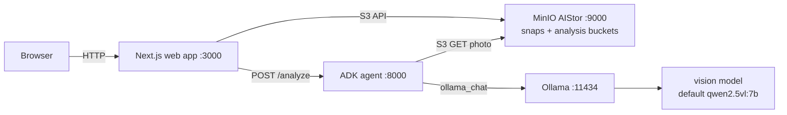
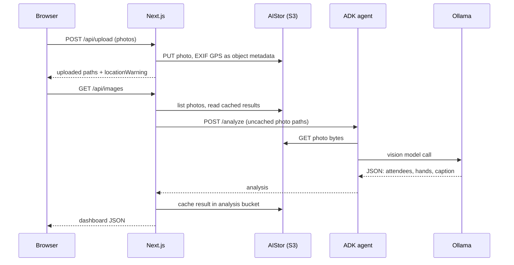
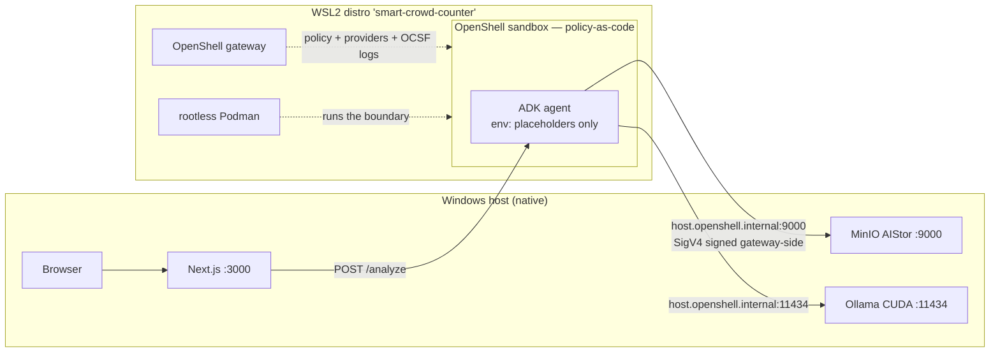

# Architecture

## Components

- `app/` — Next.js App Router pages and API routes (`app/api/*`).
- `lib/` — server modules: `storage.ts` (S3 client), `analysis.ts` (agent HTTP client), `crowd.ts` (types, validation, prompt pattern), `gps.ts` (EXIF parsing), `reset-token.ts` (HMAC retry tokens), plus API helpers.
- `agent/` — Google ADK agent (`agent/src/smart_crowd_counter/`): a FastAPI service exposing `POST /analyze` and `GET /health`, talking to Ollama via LiteLLM (`ollama_chat/<AGENT_MODEL>`).
- `components/` — React UI components.
- `scripts/` — `dev.ps1` / `dev.sh` one-command local stack launchers, `dev-governed.sh` governed path, `check-gps.mjs`, provisioning helpers.
- `docker/` — `mc.Dockerfile` for the `aistor-init` compose job.
- `openshell/` — sandbox policy and profile for governed mode.

## Data flow

## Prompt pattern and caching

One vision-model call per photo asks for JSON:
`{ total_attendees, raised_hands, percentage_with_hands_up, caption }`.
The agent fetches the photo from `snaps`, downscales an in-memory copy
(<= `MAX_INFERENCE_DIMENSION`, default 1280 px) to fit the Ollama context
window, and prompts the model. Results are stamped onto the photo's S3
metadata/tags and cached as `<photo>.json` in the `analysis` bucket, so
analyzed photos are never sent to the model again.

## Conventions

- Configuration comes from plain environment variables (see [Environment Setup](setup.md)); the app never reads credential files.
- Storage code uses only the S3 API, so community MinIO and AIStor are interchangeable.
- GPS is stored as MinIO object metadata at upload time — no sidecar database.
- In Docker Compose, `aistor-init` provisions the buckets and the scoped service user; the web app authenticates with `S3_APP_USER`/`S3_APP_SECRET`, never the root credentials.

## Governed mode (OpenShell)

By default the agent runs as a plain local process with real S3 credentials in
its environment — fine for a demo, not fine when the agent is an LLM that reads
files and makes network calls. [NVIDIA OpenShell](https://github.com/NVIDIA/OpenShell)
puts the agent in a sandbox with policy-as-code: default-deny network egress,
Landlock filesystem allowlists, a non-root identity, and credentials that never
reach the workload.

Run it with `scripts/dev-governed.sh` (see the
[demo walkthrough](governed-agent.md) and [design notes](openshell.md)). On
Windows this is a **native Windows + WSL2 combo**: the Windows host runs
Ollama (CUDA), MinIO AIStor and Next.js; a WSL2 distro (`smart-crowd-counter`,
imported from a golden tar) runs only the OpenShell gateway, rootless Podman,
and the sandboxed agent.

Before/after trust story:

| | Default (`dev.sh` / `dev.ps1`) | Governed (`dev-governed.sh`) |
|---|---|---|
| Agent network | anything the machine can reach | only `host.openshell.internal:11434` (Ollama) and `:9000` (AIStor) |
| Agent filesystem | the whole distro/host user space | Landlock allowlist (`/usr`, `/etc`, `/sandbox`, `/tmp`); `/.openshell` protected |
| Agent identity | your user | uid 1500 `sandbox`, non-root |
| S3 credentials in agent env | real service-account keys | opaque `openshell:resolve:env:...` placeholders; the gateway re-signs SigV4 and the workload never sees the secret |
| Evidence | none | OCSF deny log lines, `openshell policy get --full`, CI schema-conformance test |

The web app's contract is unchanged (`POST /analyze {path}`); the agent remains
the only LLM boundary.
