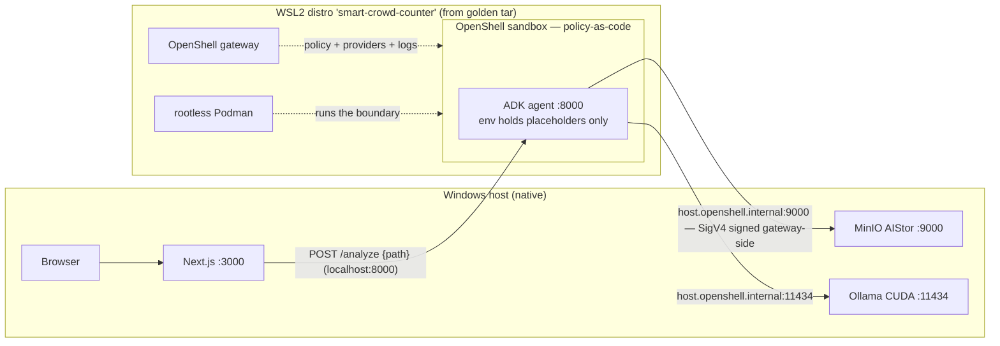

# OpenShell Integration — Design Notes

Design notes for governing the Smart Crowd Counter analysis agent with NVIDIA
OpenShell. The versioned intent artifact is
[`docs/idd/part-1-openshell-security.idd.md`](idd/part-1-openshell-security.idd.md);
implementation commits are reviewed against it.

**Verification metadata**

- NVIDIA OpenShell docs verified against version **Latest = v0.1.8**
  (`https://docs.nvidia.com/openshell/latest/llms.txt`).
- Every reference link in [§8](#8-authoritative-openshell-references) returned
  **HTTP 200** on **2026-11-11 (UTC)** via `curl -sL -o /dev/null -w '%{http_code}'`.
- Field-level cross-check against the OpenShell source:
  `github.com/NVIDIA/OpenShell` @ `f1ce6930710a76a5fac4d423b2c1b318ace3839b`
  (`providers/`, `docs/**/*.mdx`, `crates/openshell-policy-schema/`).
- `openshell` CLI version: pinned in the golden image (commit 2); the recorded
  `openshell --version` output is added to this file by that commit. When docs
  and the installed CLI disagree, **the installed CLI wins** (verified with
  `openshell <cmd> --help`).

## 1. Platform model — NATIVE WINDOWS + WSL2 COMBO

> The Windows demo is a **native Windows + WSL2 combo**. The **Windows host**
> runs Ollama (CUDA), MinIO AIStor, and the Next.js app natively. The **WSL2
> distro** runs **only** the OpenShell gateway, rootless headless Podman, and
> the sandboxed agent. Ollama is never run inside WSL2 — model weights live in
> VRAM on the Windows host.

The WSL2 project distro is imported from a golden tar with the **project
name** as the distro name (`wsl --import smart-crowd-counter <golden.tar>`),
so the golden image stays pristine and each project gets a reproducible,
resettable distro (`wsl --unregister smart-crowd-counter` + re-import).

Provisioning is platform-aware with three first-class targets:

| Target | Gateway | Isolation | Landlock check |
| ------ | ------- | --------- | -------------- |
| `windows+wsl2` | WSL2 distro from golden tar (`wsl --import`), `.wslconfig` written by the provision script | rootless Podman in the distro | required (ABI ≥ 3) |
| `linux` | native on the Linux host — same scripts, no WSL layer | rootless Podman | required (ABI ≥ 3) |
| `macos` | native on the Mac | container isolation boundary (Podman machine) instead of Landlock | skipped — substitute the documented macOS runtime check; never fake or skip verification |

## 2. Component × platform matrix

| Component | `windows+wsl2` | `linux` | `macos` |
| --------- | -------------- | ------- | ------- |
| Next.js web app + browser | Windows host (native) | Linux host | macOS host |
| MinIO AIStor (`:9000`) | Windows host (native) | Linux host | macOS host |
| Ollama (`:11434`) | Windows host, CUDA | Linux host | macOS host |
| OpenShell gateway | WSL2 distro `smart-crowd-counter` | native | native |
| Compute runtime | rootless headless Podman (Podman 5.x, cgroups v2, user socket) in the WSL2 distro | same, on the host | Podman machine |
| Sandboxed ADK agent | inside an `openshell sandbox create` sandbox | same | same |
| Filesystem isolation | Landlock (ABI ≥ 3 check required) inside the Podman container | Landlock (ABI ≥ 3) | container boundary (Landlock check replaced by the documented macOS runtime check) |
| `.wslconfig` | written by the provision script (scaled, §5) | n/a | n/a |
| Docker Desktop | documented as a supported alternative only — **not** the demo path | same | same |

Host-local services are reached from inside a sandbox via
`host.openshell.internal`, **never** `127.0.0.1`/`localhost` — network policy
never authorizes loopback.

## 3. Architecture mapping

| OpenShell concept | In this repo | Governing artifact |
| ----------------- | ------------ | ------------------ |
| Gateway (control plane: sandboxes, policy, providers, logs) | runs in the WSL2 distro / native Linux / macOS | `openshell gateway` + registered gateway (commits 2, 7) |
| Compute driver `podman` | rootless headless Podman | gateway config `compute_driver = "podman"` (commits 2, 7) |
| Sandbox | the ADK agent (`agent/`) as the main process | `openshell sandbox create` (commit 7) |
| Provider profile `ollama-openai` (category `inference`, credentialless) | Ollama on the Windows host at `host.openshell.internal:11434` | `openshell/profile/ollama-openai.yaml` (commit 4) |
| Provider profile `minio-aistor-s3` (category `data`, static creds + SigV4) | MinIO AIStor at `host.openshell.internal:9000` | `openshell/profile/minio-aistor-s3.yaml` (commit 5) |
| Sandbox policy (schema-valid fields only) | filesystem + process + network rules for the agent | `openshell/policy/crowd-counter-agent.yaml` (commit 6) |
| Credential substitution | gateway/supervisor signs SigV4; the workload env holds only placeholders | evidence captured in commit 5; deny evidence in commit 8 |
| Observability (OCSF JSON export) | deny/allow evidence artifact | `scripts/deny-evidence.sh` (commit 8) |

The web app's contract is unchanged: `POST /analyze {path}` to the agent. The
agent is the **only** LLM boundary — Next.js never sends prompts and never
calls model-serving endpoints directly (parked decision recorded in the IDD
artifact).

## 4. Topology

## 5. Resource budget

Rules (implemented by the provision script, never hardcoded):

- WSL2 memory cap = `clamp(hostRAM × 0.375, 4 GB, 16 GB)` → 16 GB host → 6 GB,
  24 GB → 9 GB, 32 GB → 12 GB, 64 GB → 16 GB.
- `processors = min(4, hostCores / 2)`; `swap = 8 GB`; `autoMemoryReclaim = gradual`.
- Free-VRAM check: warn if < 6 GB free (qwen2.5vl:7b Q4 needs ~5.5 GB) and
  suggest the `qwen2.5vl:3b` fallback.
- Ollama: `OLLAMA_MAX_LOADED_MODELS=1`, `OLLAMA_KEEP_ALIVE=2m`.

Computed for this demo machine (16 GB RAM, 16 logical processors — the minimum
demo spec, not the ceiling): `.wslconfig` memory **6 GB**, processors **4**,
swap **8 GB**.

| Pool | Budget |
| ---- | ------ |
| Windows host total | ~9 GB (baseline 4.5, Ollama 1, AIStor 0.5, Next.js 1.5, browser 1.5) |
| WSL2 distro total | ~2 GB used (distro + Podman 0.5, gateway 0.5, sandboxed agent 0.7–1) |
| Headroom | ~5 GB on the 16 GB spec — target zero Windows freezes |

Footprint targets: `vmmem` < ~3 GB after 10 min idle; `vmmem` < 4 GB during an
analysis run. Ollama weights live in VRAM (~5.5 / 8 GB) — never run Ollama
inside WSL2.

## 6. Corrections vs. bounded-boxer

[bounded-boxer](https://github.com/kameshsampath/bounded-boxer) (checked @
`b1d9f7505a8017eeb7e9754ac722baae8848943b`) is the past-mistakes reference.
This integration corrects it as follows:

| bounded-boxer did | Why it is wrong | Here |
| ----------------- | --------------- | ---- |
| `masked_paths`, `default_egress`, `no_new_privileges` in `2-governed/policy.yaml` | None of these exist in the OpenShell policy schema (verified absent from NVIDIA/OpenShell @ `f1ce693`; the schema lists only `version`, `filesystem_policy`, `landlock`, `process`, `network_policies`, `network_middlewares`). Unknown fields are rejected by the gateway; default-deny egress and seccomp are implicit. | Policy YAML uses only the six schema fields; commit 8 adds a CI allowlist test generated from the schema so an invented field fails CI. |
| Hand-rolled `bwrap` launcher (`scripts/sandbox.sh`) | Isolation must come only from an OpenShell-supported runtime. | Rootless headless Podman driver (`compute_driver = "podman"`); Docker Desktop documented as a supported alternative only. |
| `127.0.0.1:11434` endpoint and `localhost` targets in `2-governed/policy.yaml` / `run.sh` | Network policy never authorizes loopback. | All host-local services via `host.openshell.internal`. |
| Masking a secret file as the filesystem control | `masked_paths` is not a schema field; the real control is `filesystem_policy` allowlists (default-deny). | Minimal `filesystem_policy` (`read_only`/`read_write`) + Landlock `hard_requirement` on linux/wsl2. |
| Workload-held credentials | Private-AI demo requires the workload to hold only placeholders. | Static S3 creds bound to the AIStor endpoint with gateway-side SigV4 (`credential_signing: sigv4`, `signing_service: s3`); a request to any other host fails with `credential_endpoint_mismatch` (captured as evidence in commit 5). |

## 7. Commit map

| Commit | Artifact | Reference section |
| ------ | -------- | ----------------- |
| 1 `docs: OpenShell integration design notes` | this file | §8 |
| 2 `feat(scripts): platform-aware governed-environment provisioning` | `scripts/provision/` | §8 sandboxes/runtimes, gateways, repo/SDKs |
| 3 `feat(agent): sandbox-ready workload image` | `agent/Dockerfile.sandbox` | §8 sandboxes/overview (image layout `/sandbox/.venv/**`) |
| 4 `feat(openshell): Ollama inference provider profile` | `openshell/profile/ollama-openai.yaml` | §8 providers + inference |
| 5 `feat(openshell): MinIO S3 data provider profile` | `openshell/profile/minio-aistor-s3.yaml` | §8 providers/profiles + aws |
| 6 `feat(openshell): sandbox policy for the crowd-counter agent` | `openshell/policy/crowd-counter-agent.yaml` | §8 policies |
| 7 `feat(scripts): governed launch path` | `scripts/dev-governed.sh` | §8 gateways, sandboxes, tutorials |
| 8 `test: deny evidence + schema conformance` | `__tests__/openshell/`, `scripts/deny-evidence.sh` | §8 policies, observability, security, repo/SDKs |
| 9 `docs: governed-agent README + demo walkthrough` | `docs/governed-agent.md` | §8 all |
| 10 `docs: README improvements and practical applications` | `README.md` | §8 concepts |

## 8. Authoritative OpenShell references

All URLs use `/latest/` paths and returned HTTP 200 on 2026-11-11. Each entry
names the commit/decision it backs. Append `.md` to any docs URL for the clean
Markdown version; `https://docs.nvidia.com/openshell/llms.txt` is the full
index.

**Concepts** — back commits 1, 7, 9

- <https://docs.nvidia.com/openshell/latest/about/overview> — what OpenShell is
- <https://docs.nvidia.com/openshell/latest/about/architecture> — gateway /
  supervisor / sandbox / driver / provider split (§3, §4)
- <https://docs.nvidia.com/openshell/latest/about/run-your-first-agent> — image,
  provider, policy workflow (commits 3, 4, 7)

**Policies** — back commits 6, 8

- <https://docs.nvidia.com/openshell/latest/how-it-works/policies/schema> —
  the six allowed top-level fields and their subfields; the source of the
  commit-8 CI allowlist
- <https://docs.nvidia.com/openshell/latest/how-it-works/policies/network-rules> —
  rule structure, binary matching, endpoint objects, `host.openshell.internal`
- <https://docs.nvidia.com/openshell/latest/how-it-works/policies/manage-policies> —
  applying policies; error table incl. `credential_endpoint_mismatch`
- <https://docs.nvidia.com/openshell/latest/how-it-works/policies/prover> —
  formal verification of network rules; CI usage in commit 8

**Providers** — back commits 4, 5

- <https://docs.nvidia.com/openshell/latest/how-it-works/providers/overview> —
  providers, attachments, endpoint-bound credentials
- <https://docs.nvidia.com/openshell/latest/how-it-works/providers/profiles> —
  profile schema: `category` enum (`inference`, `data`, …), `credentials`,
  `endpoints` with `credential_signing: sigv4` / `signing_service: s3`,
  `binaries`, lint/import flow
- <https://docs.nvidia.com/openshell/latest/how-it-works/inference> — the
  documented credentialless `ollama-openai` profile for host-local Ollama at
  `host.openshell.internal:11434` (commit 4)
- <https://docs.nvidia.com/openshell/latest/how-it-works/providers/aws> —
  S3-style provider pattern the MinIO profile mirrors (commit 5)

**Sandboxes and runtimes** — back commits 2, 3, 7

- <https://docs.nvidia.com/openshell/latest/how-it-works/sandboxes/overview> —
  `openshell sandbox create`, image requirements, `/sandbox/.venv/**` layout
- <https://docs.nvidia.com/openshell/latest/how-it-works/sandboxes/runtimes> —
  Podman driver: rootless, Podman 5.x, cgroups v2, `systemctl --user start
  podman.socket`, `compute_driver = "podman"`, macOS podman machine
- <https://docs.nvidia.com/openshell/latest/extensibility/isolation-backends> —
  supervisor/enforcement split; no hand-rolled launchers

**Gateways** — back commits 2, 7

- <https://docs.nvidia.com/openshell/latest/how-it-works/gateways/overview> —
  running/registering a gateway; sandboxes and policies go through it

**Observability** — backs commit 8

- <https://docs.nvidia.com/openshell/latest/observability/ocsf-json-export> —
  OCSF JSON log export used as the deny-evidence artifact

**Security** — backs commits 5, 6, 8

- <https://docs.nvidia.com/openshell/latest/security/best-practices> —
  deny-by-default egress, least-privilege profiles

**Tutorials** — backs commit 7

- <https://docs.nvidia.com/openshell/latest/tutorials/first-network-policy> —
  end-to-end first network policy

**Repo / SDKs** — back commits 2 (CLI pin), 8 (schema allowlist)

- <https://github.com/NVIDIA/OpenShell> — source; `install.sh` is the
  documented installer (`curl -LsSf .../install.sh | sh`)
- <https://github.com/NVIDIA/OpenShell/tree/main/providers> — example provider
  profiles (`aws-s3.yaml` is the template for the MinIO profile)
- <https://github.com/NVIDIA/OpenShell/blob/main/crates/openshell-policy-schema/src/lib.rs> —
  the schema implementation the CI allowlist is generated from

## 9. Verification log

How the claims above were verified (anti-hallucination protocol from the IDD):

1. Every URL in §8 fetched with `curl -sL` on 2026-11-11 UTC; status 200 each.
2. Page content read in Markdown form (`<url>.md`) — e.g. the policy schema
   top-level table, the `ollama-openai` profile in the inference page, the
   `category` enum and SigV4 endpoint fields in the profiles page.
3. Field existence cross-checked in source @ `f1ce693`: `masked_paths` returns
   zero hits in NVIDIA/OpenShell; `filesystem_policy`, `network_middlewares`,
   `run_as_user`, `host.openshell.internal`, `credential_signing`, and
   `"ollama-openai"` all confirmed.
4. bounded-boxer mistakes confirmed in its source @ `b1d9f750` (§6).
